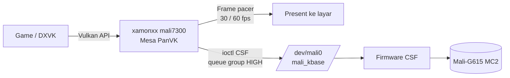

# ⚡ xamonxx mali7300

### Driver Vulkan open-source untuk **Mali-G615 MC2** · Infinix Note 50X 5G

**Mesa PanVK** yang berbicara langsung ke kernel `mali_kbase` bawaan Android:
tanpa root dan tanpa kernel custom. Dilengkapi **frame pacer presisi** untuk FPS **30 / 60 yang stabil**.

 

 
-3ddc84?style=for-the-badge&logo=android&logoColor=white)

[**⬇️ Download**](../../releases/latest) · [**📦 Cara Pasang**](#-cara-pasang) · [**⚙️ Cara Kerja**](#%EF%B8%8F-cara-kerja) · [**🧪 Hasil Audit**](docs/CANDIDATES.md) · [**🛠️ Build**](docs/BUILD.md)

---

> [!WARNING]
> **Driver eksperimental.** Ini bukan driver resmi Arm atau MediaTek. Basisnya sudah diuji pada Mali-G615 **MC6**
> (Poco X6 Pro), tetapi **varian MC2 milik Note 50X belum pernah diuji**. Simpan driver bawaan sebagai cadangan.

## ✨ Sorotan

| | Fitur | Penjelasan singkat |
|:-:|---|---|
| 🎯 | **Frame pacer presisi** | Deadline absolut `CLOCK_MONOTONIC` dan `clock_nanosleep` tanpa busy-wait. Frame time rata, GPU sempat istirahat, panas turun, sehingga throttling lebih jarang. |
| 🧠 | **Bicara langsung ke chipset** | PanVK memakai antarmuka **CSF (Command Stream Frontend)** milik `mali_kbase` (`/dev/mali0`). Queue group diberi prioritas **HIGH** supaya tidak dirotasi scheduler firmware. |
| ⚡ | **Sinkronisasi di GPU** | Semaphore dalam satu antrian ditunggu oleh GPU, bukan CPU (hemat ±21 ms CPU per frame menurut data basis). |
| 🗜️ | **Hemat bandwidth** | Tekstur BCn di-decode ke shadow **AFRC** terkompresi. Cocok untuk LPDDR4X dan GPU 2-core. |
| 🛠️ | **Dikompilasi khusus CPU ini** | `-march=armv8.2-a+crypto+dotprod+fp16+rcpc -mtune=cortex-a78`, sesuai flag CPU hasil audit perangkat. |
| 🔒 | **Tanpa root** | Hanya memakai node `/dev/mali0` yang memang bisa diakses aplikasi. |

## 📱 Perangkat target

| Komponen | Detail | Label |
|---|---|---|
| Model | Infinix X6857 · Note 50X 5G | VERIFIED |
| SoC | MediaTek Dimensity 7300 (MT6878), 4 nm | DERIVED + OFFICIAL |
| CPU | 4× Cortex-A78 @ 2.5 GHz + 4× Cortex-A55 @ 2.0 GHz | VERIFIED |
| GPU | Arm Mali-G615 **MC2** (pan arch v11, CSF) | OFFICIAL |
| RAM | 8 GB LPDDR4X | VERIFIED + OFFICIAL |
| OS | Android 16 (SDK 36), kernel 6.1 | VERIFIED |
| Layar | LCD 720 × 1600, 120 Hz | OFFICIAL |

Audit lengkap ada di [`docs/DEVICE_INFO.md`](docs/DEVICE_INFO.md).

## 📦 Pilih varian

| File | Frame pacer | Cocok untuk |
|---|:-:|---|
| `xamonxx_mali7300V0.1-stable30.zip` | **30 fps** | GTA V dan game berat. Paling stabil dan paling adem. **Disarankan pertama.** |
| `xamonxx_mali7300V0.1-stable60.zip` | **60 fps** | Game ringan–menengah, atau GTA V dengan setting sangat rendah. |
| `…-freedreno.zip` | sama | Cadangan untuk launcher yang hanya mau nama `libvulkan_freedreno.so`. |

> [!TIP]
> Jika launcher juga punya **Target FPS**, angka terendah yang berlaku. Contoh: pakai **stable30** lalu set Target FPS 30 juga.

## 🚀 Cara pasang

1. Download zip dari halaman [**Releases**](../../releases/latest). **Jangan di-extract.**
2. Buka launcher, lalu **Settings → Import driver (.zip)** dan pilih `xamonxx_mali7300V0.1-stable30.zip`.
3. Pastikan nama **`xamonxx mali7300 V0.1 Stable30`** muncul di pilihan *Vulkan Driver*.
4. Jalankan **Benchmark Runs**, lalu bandingkan hasilnya dengan driver bawaan.
5. Jika gagal dimuat, coba varian `-freedreno.zip`. Jika masih gagal, kembali ke driver bawaan dengan **Remove a driver**.

Setting game untuk GTA V ada di [`docs/COMMANDLINE.md`](docs/COMMANDLINE.md).

## ⚙️ Cara kerja

1. **Driver** = Mesa PanVK (open-source) dengan ±175 patch kbase dari proyek basis.
2. **Patch xamonxx** = frame pacer di jalur present (Android dan X11/Winlator).
3. **Build** = GitHub Actions dengan Android NDK r29, flag CPU khusus A78/A55, `-O3`, dan ThinLTO, lalu diaudit otomatis.

Detail teknis ada di [`docs/BUILD.md`](docs/BUILD.md).

## 🧪 Hasil audit kandidat

| # | Driver | Mesa | G615 | Audit |
|:-:|---|---|:-:|:-:|
| 🥇 | zenithblue-oss/panvk-kbase-android v26.3.1 (**basis build**) | 26.3-devel | Diuji (MC6) | ✅ PASS · checksum cocok |
| 🥈 | JimVulkan/mali-panvk v1.6.0 (r10) | 27.0-devel | Diuji 1 tester | ✅ PASS · `libc++.so` dinamis |
| 🥉 | MineGraph-bilibili/panvk-Android panvk.8 | 26.3 | Diklaim | ✅ PASS |

Rincian lengkap ada di [`docs/CANDIDATES.md`](docs/CANDIDATES.md).

## ❓ FAQ

<b>Apakah ini bikin FPS naik?</b>

Driver tidak menambah core atau clock GPU. Yang diperbaiki adalah **kestabilan**: frame time lebih rata dan panas lebih rendah,
jadi throttling lebih jarang. Angka FPS nyata baru diketahui dari benchmark di HP kamu.

<b>Kenapa tidak pakai Turnip?</b>

Turnip hanya untuk GPU **Adreno** (Qualcomm). Note 50X memakai **Mali** (Arm), jadi driver open-source yang tepat adalah **PanVK**.

<b>Apakah aman?</b>

Driver tidak butuh root dan tidak mengubah sistem. Proteksi termal kernel tetap aktif. Kalau bermasalah, hapus saja driver dari launcher.

## 🙏 Kredit

[Mesa3D / PanVK](https://gitlab.freedesktop.org/mesa/mesa) ·
[zenithblue-oss/panvk-kbase-android](https://github.com/zenithblue-oss/panvk-kbase-android) (patch kbase/CSF) ·
[JimVulkan/mali-panvk](https://github.com/JimVulkan/mali-panvk) ·
[wonderkast02/panvk-g720-kbase-csf](https://github.com/wonderkast02/panvk-g720-kbase-csf) ·
[leegao](https://github.com/leegao) · Arm (header UAPI kbase).

Lisensi: kode Mesa MIT, header kbase **GPL-2.0 WITH Linux-syscall-note**, script proyek ini MIT. Lihat [`NOTICE.md`](NOTICE.md).

Dibuat oleh <b>xamonxx</b> untuk Infinix Note 50X 5G

