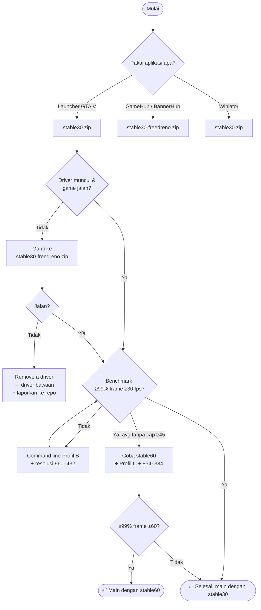

# 🧭 Panduan memilih driver

Satu halaman untuk menentukan zip mana yang dipakai, lalu setting apa yang menyertainya.

## 1️⃣ Pohon keputusan



## 2️⃣ Tabel cepat

| Situasi | Driver | Command line | Resolusi | Target FPS launcher |
|---|---|---|---|:-:|
| GTA V, pertama kali | **stable30** | Profil A | 1066×480 | 30 |
| HP cepat panas / kota ramai | stable30 | Profil B | 960×432 | 30 |
| GPU masih longgar (≥45 fps tanpa cap) | stable60 | Profil C | 854×384 | 60 |
| Driver gagal dimuat | `…-freedreno` | sama | sama | sama |
| GameHub / BannerHub | `…-freedreno` | — | — | — |

## 3️⃣ Arti nama file

```
xamonxx_mali7300V0.1-stable30-freedreno.zip
└──┬──┘ └──┬───┘└┬─┘ └───┬──┘ └────┬───┘
 author  device versi  frame pacer  nama library di dalam zip
                        (30/60 fps)  (tanpa label = libvulkan_panfrost.so)
```

## 4️⃣ Varian `stable30` vs `stable60`

| | stable30 | stable60 |
|---|---|---|
| Frame time target | 33,3 ms | 16,7 ms |
| Kestabilan di GTA V | ⭐⭐⭐⭐⭐ | ⭐⭐ (tergantung setting) |
| Suhu | 🧊 Paling adem | 🔥 Lebih panas |
| Baterai | Hemat | Boros |
| Cocok untuk | GTA V, game berat | Game ringan, emulator ringan |

> [!NOTE]
> Bila launcher juga punya **Target FPS**, angka **terendah** yang berlaku. `stable60` + Target FPS 30 tetap 30 fps.
> Di Winlator, cap bisa diganti tanpa ganti zip: env var `XAMONXX_FPS_CAP=30`, `40`, `45`, `60`, atau `0` (mati).

## 5️⃣ Checklist sebelum benchmark
- [ ] Refresh layar **60 Hz** (untuk target 30/60)
- [ ] Aplikasi latar ditutup
- [ ] Game Mode XOS aktif, bypass charging bila sedang dicas
- [ ] Casing dilepas untuk sesi panjang
- [ ] Ubah **satu** hal per benchmark
